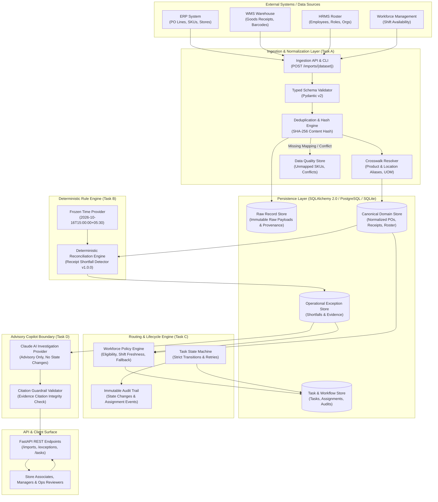
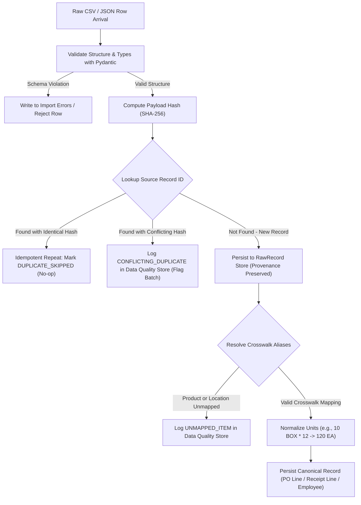
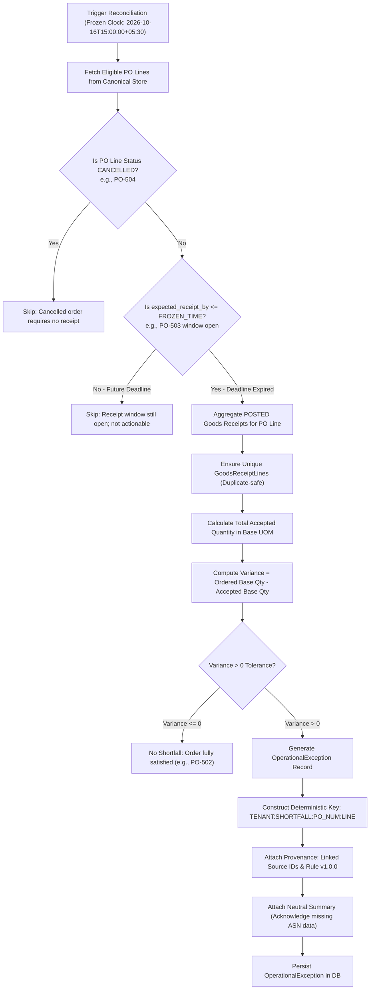
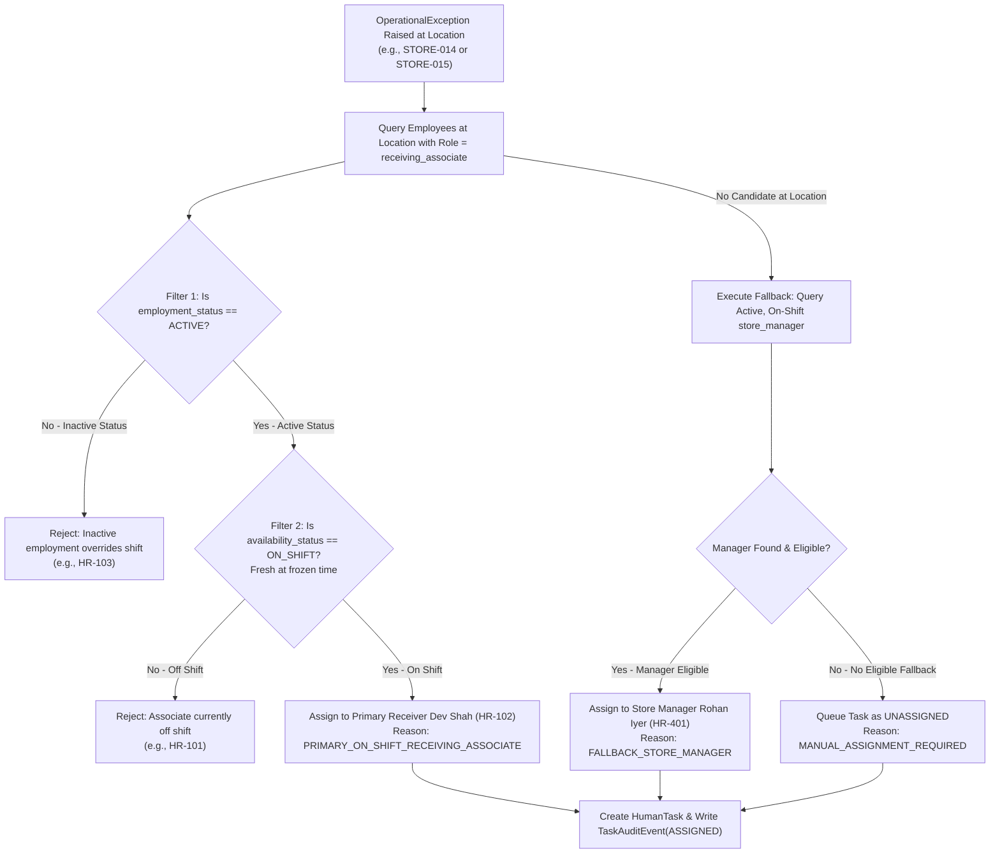
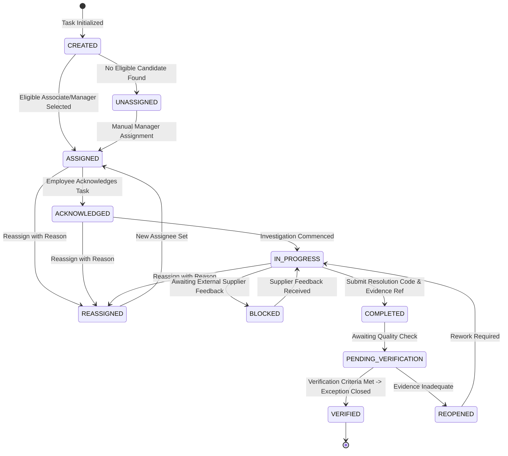
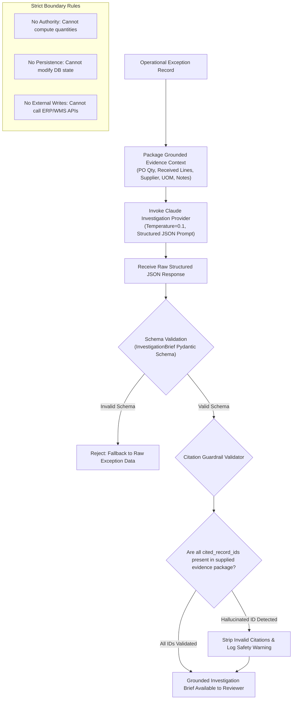
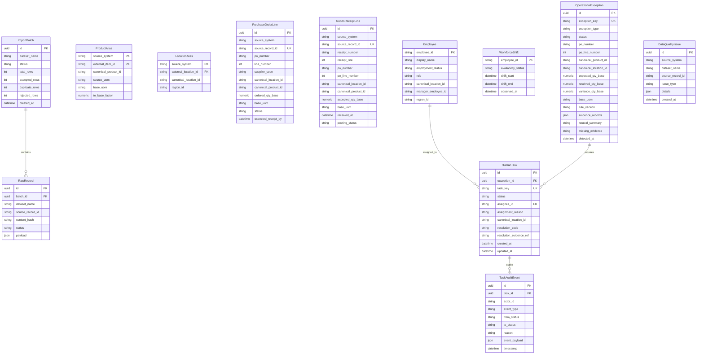

# OPSIB Backend Architecture Specification
**Retail Data Integration, Exception Detection & Task Reliability**

---

## 1. System Overview & Purpose

OPSIB is an operational intelligence backend designed to bridge disparate retail systems (ERP, WMS, HRMS, and Workforce Management). Its primary purpose is to:
1. Ingest messy, siloed datasets (with disparate product/location identifiers, conflicting units of measure, and duplicate transmissions).
2. Normalize and reconcile records into a canonical representation while preserving raw provenance.
3. Deterministically detect operational exceptions—specifically goods receipt shortfalls against purchase orders—without making unverified root-cause accusations.
4. Route actionable tasks to eligible, on-shift personnel using organizational fallback rules.
5. Manage an auditable task lifecycle with server-enforced state transitions and idempotent retries.
6. Provide an optional, tightly-sandboxed AI investigation advisory boundary with citation verification.

---

## 2. System Architecture Diagram

---

## 3. Detailed Data Flows & Pipelines

### 3.1 Ingestion, Deduplication & Data Quality Pipeline (Task A)

---

### 3.2 Deterministic Reconciliation & Shortfall Detector (Task B)

---

### 3.3 Workforce Routing & Fallback Decision Flow (Task C)

---

### 3.4 Task State Machine & Verification Lifecycle (Task C)

---

### 3.5 Claude AI Advisory Boundary & Guardrail Architecture (Task D)

---

## 4. Entity-Relationship Architecture

---

## 5. Architectural Decision Records (ADRs)

### ADR-1: Two-Tier Storage Architecture (Raw Provenance vs Canonical Domain Model)
- **Status:** Accepted
- **Context:** Source ERP and WMS systems supply heterogeneous identifiers, different column names, and varying units of measure. Reconciling directly against raw CSV structures makes detection rules fragile and tightly coupled to current source formats.
- **Decision:** Implement a two-tier storage architecture:
  1. **Raw Tier (`RawRecord`, `ImportBatch`):** Stores unmutated raw payloads, content hashes (SHA-256), source system name, and batch identifiers. This guarantees complete lineage and non-repudiation.
  2. **Canonical Tier (`PurchaseOrderLine`, `GoodsReceiptLine`, `Employee`):** Clean, strongly-typed entities with normalized product identifiers (`SKU-001`), canonical locations (`STORE-014`), and standardized base units (`EA`).
- **Why:** Separating raw ingestion from canonical state allows future retailer formats to be integrated simply by adding a mapping adapter, without changing the reconciliation rules.
- **Trade-offs:** Additional database write per record and slight schema overhead, but delivers audit traceability and decoupling.

---

### ADR-2: Idempotency & Conflict Policy (Duplicate Detection vs Business Change)
- **Status:** Accepted
- **Context:** CSV exports from retail backends often repeat rows across daily batches. Occasionally, a previously received source ID is retransmitted with altered values (e.g. quantity modified from 20 to 15).
- **Decision:**
  - Enforce a database unique constraint on `(source_system, source_record_id)`.
  - On arrival of an existing `source_record_id`:
    - Compute `SHA-256` content hash of incoming payload.
    - If hash matches existing record $\rightarrow$ **Idempotent Duplicate**: Return existing record status, log `DUPLICATE_SKIPPED`, do not double-count quantities.
    - If hash differs $\rightarrow$ **Conflicting Update**: Do *not* silently overwrite existing business state. Create a `DataQualityIssue` record (`CONFLICTING_DUPLICATE`), mark row for human operational review, and preserve both versions.
- **Why:** Prevents stock distortion (e.g., PO-506 where GRN was duplicated) while preventing unauthorized mutations of already posted operational facts.
- **Trade-offs:** In-place updates require explicit data-correction workflows rather than automatic silent overwrites.

---

### ADR-3: Temporal Isolation & Frozen Clock Execution
- **Status:** Accepted
- **Context:** Assessment scenario logic relies on exact evaluation timing (`2026-10-16T15:00:00+05:30`). For example, PO-503 has an expected receipt deadline of `2026-10-17T18:00:00+05:30`. If the detector queries the local system clock (`datetime.now()`), PO-503 would prematurely trigger a false shortfall exception.
- **Decision:**
  - Introduce a central `ClockProvider` / `get_current_time()` configured to the frozen timestamp `2026-10-16T15:00:00+05:30`.
  - All deadline boundary checks and shift availability evaluations inject this provider.
- **Why:** Guarantees deterministic, reproducible test results and isolates business logic from server execution environments.
- **Trade-offs:** In production, the clock provider reads UTC system time; in test and historical backfill modes, it reads the target evaluation window.

---

### ADR-4: Decoupling Operational Exceptions from Human Tasks
- **Status:** Accepted
- **Context:** An operational anomaly (receipt shortfall) is a business finding. A task is actionable human labor. Conflating the two creates major bugs: reassigning a task should not delete or re-detect the exception; closing an exception may require multiple coordinated tasks.
- **Decision:**
  - Create separate database entities: `OperationalException` and `HumanTask`.
  - `OperationalException` is keyed deterministically by business identity (`TENANT:RECEIPT_SHORTFALL:PO-501:L1`).
  - `HumanTask` references `exception_id` via foreign key and maintains its own state lifecycle, assignee, and resolution history.
- **Why:** Multiple tasks (e.g., dock physical search + supplier invoice adjustment) can point to the same exception. If a task is reassigned or reopened, the exception finding remains stable and unchanged.
- **Trade-offs:** Requires an additional join when querying tasks with exception details, but properly isolates operational state from human workflow.

---

### ADR-5: Server-Enforced State Machine & Idempotent Client Retry Handling
- **Status:** Accepted
- **Context:** If a client invokes `POST /tasks/{id}/complete` and the connection times out after the database commits, the client will retry the request. A naive server would return `409 Conflict` (cannot complete an already completed task), confusing the client.
- **Decision:**
  - Implement a server-enforced state machine rejecting illegal arbitrary transitions.
  - Support `Idempotency-Key` headers on mutating endpoints.
  - If a task transition request is repeated with the same intent and payload on an already transitioned task, return the existing status with `200 OK` rather than failing.
- **Why:** Eliminates duplicate work, avoids race conditions, and ensures network retry resilience.
- **Trade-offs:** Requires caching or querying previous task transition payloads.

---

### ADR-6: Epistemic Neutrality (Preserving Unknowns & Missing Evidence)
- **Status:** Accepted
- **Context:** Retail systems often jump to blaming suppliers when goods receipts are less than purchase orders. However, the available data lacks Advanced Shipping Notices (ASN) and carrier proof of delivery.
- **Decision:**
  - The detector labels findings as `RECEIPT_SHORTFALL`, never `SUPPLIER_SHORT_SHIPMENT`.
  - Findings explicitly carry metadata: `missing_evidence: ["SUPPLIER_DISPATCH_ASN", "CARRIER_POD"]`.
  - A neutral summary states the arithmetic discrepancy without inferring blame or financial liability.
- **Why:** Operational integrity. Prevents incorrect financial clawbacks and protects retailer credibility.
- **Trade-offs:** Root-cause determination is deferred to investigation rather than being automated on partial evidence.

---

### ADR-7: Claude AI Advisory Boundary with Grounded Citation Guardrails
- **Status:** Accepted
- **Context:** Large Language Models can hallucinate IDs, make arithmetic errors, and produce non-deterministic outputs if given uncontrolled operational autonomy.
- **Decision:**
  - AI is strictly restricted to an **advisory copilot role**.
  - Claude never calculates quantities, evaluates deadlines, assigns employees, or updates database records.
  - An output guardrail validator checks every cited record ID against the evidence package. Any ungrounded or hallucinated reference is stripped and flagged.
  - A typed interface (`ClaudeInvestigationProvider`) and deterministic offline mock provider are included so tests execute without external API keys or costs.
- **Why:** Guarantees enterprise safety, prevents hallucinated audits, and maintains zero external dependency for tests.
- **Trade-offs:** AI cannot execute automated resolutions, but remains 100% auditable and safe.

---

### ADR-8: Database Persistence Strategy (PostgreSQL / SQLite Dual Compatibility)
- **Status:** Accepted
- **Context:** The production target is PostgreSQL, but assessment reviewers need to execute tests immediately from a clean checkout without spinning up external database containers.
- **Decision:**
  - Use SQLAlchemy 2.0 with standard ANSI SQL datatypes and SQLite-compatible JSON handling.
  - Use SQLite in WAL (Write-Ahead Logging) mode with foreign keys enabled (`PRAGMA foreign_keys = ON`) by default for tests and single-command local runs.
  - Provide complete database connection configuration supporting PostgreSQL via environment variable `DATABASE_URL`.
- **Why:** Guarantees zero friction for review execution while maintaining full migration readiness for PostgreSQL.
- **Trade-offs:** Cannot use Postgres-specific extensions (e.g. pg_trgm) in core models, but standard SQLAlchemy models are clean and portable.

---

## 6. Trade-offs, Known Limitations & Production Hardening

### 6.1 Intentional Simplifications in Current Scope

| Area | Current Implementation | Rationale for Assessment Scope |
| :--- | :--- | :--- |
| **Worker Infrastructure** | Synchronous REST pipeline (`POST /reconciliation/run`) | Adding Celery/Kafka introduces unnecessary infrastructure complexity for a 6-scenario bounded dataset. |
| **Authentication** | Header-based mock tenant/user context (`X-Tenant-ID`, `X-User-ID`) | Full OAuth2/OIDC adds boilerplate without testing operational reconciliation logic. |
| **Database** | SQLite WAL mode by default; PostgreSQL ready | Enables instant `pytest` execution on any machine without Docker or local PostgreSQL daemon. |
| **AI Integration** | Mock provider + typed Claude API contract | Prevents financial cost or external network failures during automated test runs. |

---

### 6.2 Production Hardening Roadmap (What Changes for Live Deployment)

1. **Multi-Tenancy & Data Isolation:**
   - Add row-level security (RLS) in PostgreSQL based on `tenant_id`.
   - Ensure all queries, indexes, and unique constraints include `tenant_id` as the leading composite key column.
2. **Distributed Locks & Concurrency:**
   - Introduce Redis-backed distributed locks (`Redlock`) or Postgres advisory locks (`pg_advisory_xact_lock`) on `(tenant_id, po_number)` during reconciliation to prevent dual-worker race conditions.
3. **Secrets & Integration Credentials:**
   - Store ERP/WMS API tokens, database credentials, and Claude API keys in AWS Secrets Manager or HashiCorp Vault, injecting them into the application environment at runtime.
4. **Asynchronous Ingestion & Streaming:**
   - Transition file uploads to S3 pre-signed URLs with SQS/Kafka event triggers, processing large millions-of-rows files via streaming chunked workers.
5. **Audit Retention & Non-Repudiation:**
   - Stream `TaskAuditEvent` records to an append-only, immutable storage layer (e.g., AWS S3 Object Lock / ClickHouse) for regulatory compliance.

---

## 7. Answers to Assessment Design Questions

### Question 1: Preventing Duplicate Business Effects on Concurrent / Retried Imports
> *How do you prevent a second import or concurrent worker from creating a different result from the first import? Explain the database constraint or transaction boundary that makes your answer true.*

**Implementation Answer:**
1. **Source Level Idempotency:** A composite unique constraint `UNIQUE (source_system, source_record_id)` exists on the `canonical_po_line` and `canonical_receipt_line` tables.
2. **Transaction Boundary:** Ingestion runs inside a database transaction (`BEGIN ... COMMIT`). Before inserting, incoming records are checked against existing rows:
   - If a row exists with an identical `SHA-256` content hash, the row is flagged as `DUPLICATE_SKIPPED` and no insert occurs.
   - If a row exists with differing content, a `DataQualityIssue` is created rather than mutating existing data.
3. **Deterministic Exception Keys:** Operational exceptions use a deterministic business key:
   $$\text{exception\_key} = \text{MD5}(\text{tenant\_id} + \text{"RECEIPT_SHORTFALL"} + \text{po\_number} + \text{line\_number})$$
   A database unique constraint `UNIQUE (exception_key)` guarantees that even if reconciliation runs concurrently on two separate workers, the second worker hits an `ON CONFLICT DO NOTHING` or duplicate key boundary, preventing duplicate exceptions or duplicate tasks.

---

### Question 2: Client Timeout During Task Completion & Retry Safety
> *If the API commits task completion but the client times out before receiving the response, what happens when the client retries? Describe and implement a safe answer.*

**Implementation Answer:**
1. **Idempotency Key & Transition Guard:** When completing a task, the client submits:
   `POST /api/v1/tasks/{id}/complete` with payload `{"resolution_code": "SUPPLIER_SHORT_SHIPMENT_CONFIRMED", "evidence_ref": "REF-8842"}`.
2. **Safe Idempotent Response:**
   - The task transition handler checks the current database state of the task.
   - If `current_status == 'COMPLETED'`, the server checks whether the submitted `resolution_code` and `evidence_ref` match the stored resolution.
   - If they match, the server returns the existing task object with `200 OK` (not `409 Conflict`), acknowledging that the desired state was already achieved.
   - If the task is `COMPLETED` with *conflicting* resolution data, the server returns `409 Conflict` with an explicit error message explaining the discrepancy.
   - No duplicate audit event is written for the repeated idempotent retry.
