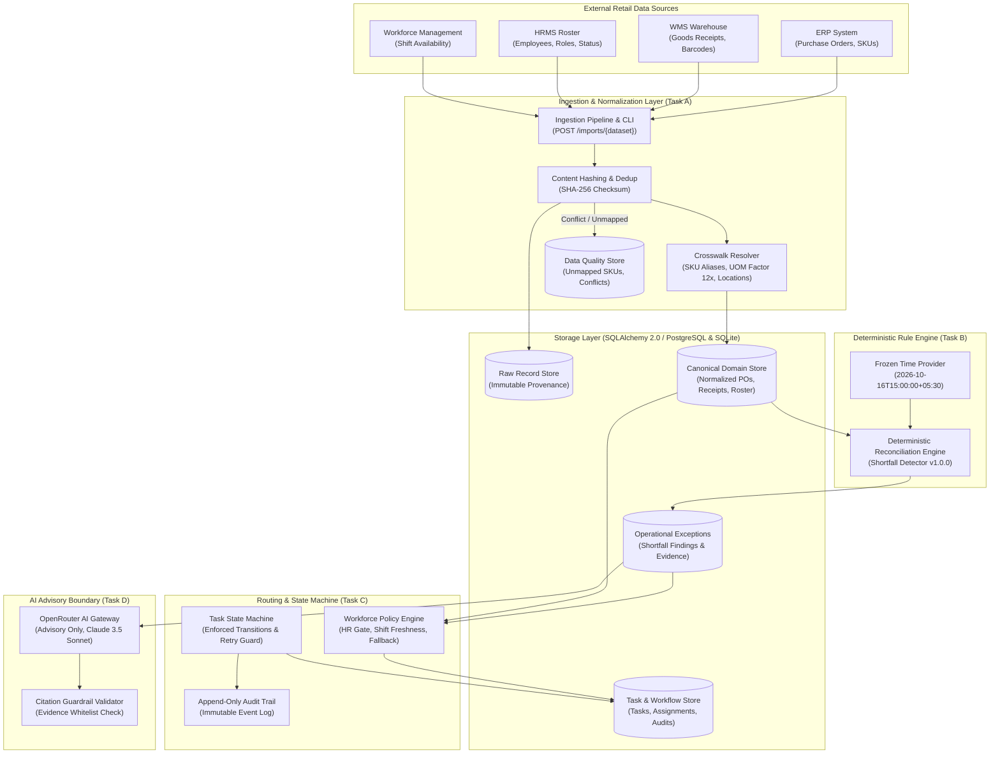

# OPSIB Retail Exception Detection & Task Reliability Engine
**Backend Engineering Assessment | Production Implementation**

[-brightgreen.svg)](#7-automated-test-suite--verification)
[](#2-system-architecture--design-principles)
[](#2-system-architecture--design-principles)
[](#3-quickstart--execution-guide)
[](./openapi.json)

---

## 1. Executive Summary

OPSIB connects messy, siloed retail systems (ERP, WMS, HRMS, and Workforce Management) to:
1. **Ingest & Normalize Heterogeneous Datasets:** Ingests disparate SKU codes, location aliases, and unit-of-measure variations (e.g. converting `BOX` of 12 into base unit `EA`).
2. **Preserve Raw Provenance & Enforce Idempotency:** Implements a two-tier storage architecture preserving unmutated source payloads with SHA-256 checksums while deduplicating repeats and isolating conflicting transmissions.
3. **Deterministically Detect Operational Shortfalls:** Evaluates receipt lines against purchase order commitments with zero tolerance against a frozen temporal anchor (`2026-10-16T15:00:00+05:30`), strictly honoring deadlines and order cancellations.
4. **Preserve Epistemic Neutrality:** Recognizes the total absence of supplier dispatch / ASN data in the evidence pack. Discrepancies are labeled `RECEIPT_SHORTFALL`, never asserting unproven supplier fault or carrier transit loss.
5. **Route Actionable Tasks to Eligible Workforce:** Implements two-tier organizational routing: primary on-shift receiving associates with fallback to store managers, while strictly enforcing shift freshness telemetry limits, active shift windows, and deterministic tie-breaking.
6. **Manage Auditable Task Lifecycles with Retry Safety:** Implements a server-enforced state machine rejecting illegal transitions and safely handling client timeout retries with `Idempotency-Key` headers without duplicate audit logs.
7. **Sandbox AI Advisory Copilot:** Integrates an OpenRouter AI boundary with deterministic mock support, providing grounded investigation summaries while enforcing strict citation whitelist guardrails against hallucinated IDs.

---

## 2. System Architecture & Design Principles



### Architectural Decision Records (ADRs) Summary

| ADR | Topic | Decision & Operational Rationale |
| :--- | :--- | :--- |
| **ADR-1** | **Two-Tier Storage Architecture** | Raw payloads are stored unmutated in `RawRecord` with SHA-256 hashes for lineage; normalized facts live in canonical domain tables (`PurchaseOrderLine`, `GoodsReceiptLine`). Allows new retailer formats to be integrated via adapters without rewriting detection rules. |
| **ADR-2** | **Duplicate & Conflict Policy** | Unique constraint on `(source_system, source_record_id)`. Identical payload hash $\rightarrow$ `DUPLICATE_SKIPPED` (idempotent no-op). Differing payload hash $\rightarrow$ logged as `DataQualityIssue(CONFLICTING_DUPLICATE)` for human review without mutating canonical state. |
| **ADR-3** | **Temporal Clock Isolation** | All business rules and shift evaluations evaluate against a frozen evaluation time (`2026-10-16T15:00:00+05:30`). Decouples execution from server clocks, preventing false shortfall alerts on open receipt windows (e.g. PO-503). |
| **ADR-4** | **Decoupled Exceptions & Tasks** | An anomaly (`OperationalException`) is a business fact; a task (`HumanTask`) is actionable human labor. Reassigning or reopening a task never duplicates or alters the exception finding. |
| **ADR-5** | **State Machine & Retry Safety** | Client timeouts on task completion retried with matching payload return `200 OK` with existing task state and write **zero** duplicate audit logs. Conflicting retry payloads return `409 Conflict`. |
| **ADR-6** | **Epistemic Neutrality** | Findings are labeled `RECEIPT_SHORTFALL`, never `SUPPLIER_SHORT_SHIPMENT`. Missing evidence metadata explicitly cites absent ASN and carrier POD data. |
| **ADR-7** | **AI Advisory Boundary** | AI acts strictly as an advisory copilot with zero write authority. All cited record IDs are validated against an evidence whitelist; ungrounded citations are stripped with safety warnings. |
| **ADR-8** | **Dual Database Compatibility** | Standard SQLAlchemy 2.0 ANSI SQL datatypes compatible with SQLite WAL mode for zero-dependency local review and PostgreSQL for production deployments. |

---

## 3. Quickstart & Execution Guide

The service is zero-config and self-contained. It runs immediately on SQLite with foreign keys and WAL mode enabled by default.

### Prerequisites
- Python 3.10+ (tested on Python 3.13)
- `git`, `pip`, `venv`

### Step 1: Environment Setup
```bash
# Clone the repository and enter directory
cd opsib-assignment

# Create and activate virtual environment
# On Linux/macOS:
python3 -m venv .venv
source .venv/bin/activate

# On Windows (PowerShell):
python -m venv .venv
.\.venv\Scripts\Activate.ps1

# Install pinned dependencies
pip install -r requirements.txt
```

### Step 2: Ingest Synthetic Fixtures (Task A)
Load all 6 companion CSV fixture datasets in strict dependency order:
```bash
python scripts/load_fixtures.py
```
*Output Summary:*
- Product aliases (6 rows) & Location aliases (6 rows) mapped.
- Employees (6 rows) & Shift statuses (6 rows) loaded.
- Purchase order lines: 7 total rows $\rightarrow$ 6 accepted, 1 intra-batch duplicate skipped (`ERP-PO506-L1`).
- Goods receipt lines: 7 total rows $\rightarrow$ 6 accepted, 1 intra-batch duplicate skipped (`WMS-GRN506-A-L1`).

### Step 3: Run Deterministic Reconciliation CLI (Task B & C)
Trigger exception detection and workforce task routing from the terminal:
```bash
python scripts/run_reconciliation.py
```
*Expected Terminal Output:*
```text
==========================================================================================
OPSIB DETERMINISTIC RECONCILIATION & TASK ROUTING ENGINE
==========================================================================================
Evaluation Clock Anchor : 2026-10-16T15:00:00+05:30
Rule Engine Version     : v1.0.0
Tenant Context          : TENANT-001
------------------------------------------------------------------------------------------
Evaluated PO Lines : 6 | Cancelled Skipped: 1 | Future Skipped   : 1
Fully Satisfied    : 1 | Shortfalls Found : 3 | New Exceptions   : 3
------------------------------------------------------------------------------------------
PO Line      Product    Location    Ordered  Recvd    Variance  Assignee     Reason
------------------------------------------------------------------------------------------
PO-501-L1    SKU-001    STORE-014   100 EA   92 EA    8 EA      HR-102       PRIMARY_ON_SHIFT_RECEIVING_ASSOCIATE
PO-505-L1    SKU-002    STORE-015   120 EA   96 EA    24 EA     HR-401       FALLBACK_STORE_MANAGER
PO-506-L1    SKU-003    STORE-014   20 EA    10 EA    10 EA     HR-102       PRIMARY_ON_SHIFT_RECEIVING_ASSOCIATE
==========================================================================================
```

### Step 4: Run the Complete Assessment Verification Suite
Execute all 136 automated unit, integration, scenario, and failure-path tests:
```bash
python scripts/run_verification.py
```
Or run pytest directly:
```bash
pytest -q
```

### Step 5: Start the REST API Server
```bash
uvicorn app.main:app --reload --port 8000
```
- Interactive OpenAPI Docs (Swagger UI): `http://localhost:8000/docs`
- ReDoc UI: `http://localhost:8000/redoc`
- Health Endpoint: `http://localhost:8000/health`

---

## 4. Mandatory Scenario Verification Matrix

The service was built and tested against the exact scenario specifications in the assessment prompt:

| Scenario | PO Details | Receipt Lines Aggregated | Deadline vs Frozen Clock | Variance / Outcome | Routing & Assignment |
| :--- | :--- | :--- | :--- | :--- | :--- |
| **PO-501** | Ordered 100 EA, `OPEN` | Split receipts: `GRN-501-A` (60 EA) + `GRN-501-B` (32 EA) = 92 EA | Passed (`2026-10-15 12:00`) | **SHORTFALL OF 8 EA** | Assigned to primary on-shift associate **`HR-102` (Dev Shah)** at `STORE-014`. |
| **PO-502** | Ordered 40 EA, `OPEN` | `GRN-502-A` (40 EA) = 40 EA | Passed (`2026-10-15 12:00`) | **NO EXCEPTION** (fully satisfied) | Order complete; 0 variance. No task created. |
| **PO-503** | Ordered 50 EA, `OPEN` | `GRN-503-A` (20 EA) = 20 EA | **Future** (`2026-10-17 18:00` > `2026-10-16 15:00`) | **NO EXCEPTION** (window still open) | Not yet actionable at frozen time. No task created. |
| **PO-504** | Ordered 20 EA, `CANCELLED` | 0 EA received | Passed (`2026-10-15 12:00`) | **NO EXCEPTION** (order cancelled) | Cancelled orders require no receipt. Filtered out. |
| **PO-505** | Ordered 10 BOX (`SKU-002`) | `GRN-505-A` (96 EA) = 96 EA | Passed (`2026-10-15 15:00`) | **SHORTFALL OF 24 EA** (120 EA base - 96 EA) | No receiving associate at `STORE-015`. Falls back to store manager **`HR-401` (Rohan Iyer)**. |
| **PO-506** | Ordered 20 EA, `OPEN` | `GRN-506-A` (10 EA) repeated twice | Passed (`2026-10-15 15:00`) | **SHORTFALL OF 10 EA** (deduped to 10 EA) | Repeated receipt row deduplicated to 10 EA. Assigned to **`HR-102`**. |

### Workforce Routing Decision Breakdown

```text
At STORE-014:
  - HR-101 (Receiving Associate): Active employment status, but availability is OFF_SHIFT -> REJECTED.
  - HR-103 (Receiving Associate): Shift export says ON_SHIFT, but HRMS employment status is INACTIVE -> REJECTED (HRMS master status wins).
  - HR-102 (Receiving Associate): Active employment status AND availability is ON_SHIFT -> SELECTED (PRIMARY_ON_SHIFT_RECEIVING_ASSOCIATE).

At STORE-015:
  - No receiving associates exist for STORE-015 in HRMS.
  - Policy executes fallback tier: query active, on-shift store managers at STORE-015.
  - HR-401 (Store Manager): Active employment status AND availability is ON_SHIFT -> SELECTED (FALLBACK_STORE_MANAGER).

Regional Operations Scope:
  - HR-501 (Regional Operations): Region-scoped (REGION-MH) with null store location.
  - Handled safely: not forced into store-level tasks, avoiding database integrity crashes.
```

---

## 5. Answers to Assessment Design Questions

### Question 1: Preventing Duplicate Business Effects on Concurrent / Retried Imports
> *How do you prevent a second import or concurrent worker from creating a different result from the first import? Explain the database constraint or transaction boundary that makes your answer true.*

**Implementation Answer:**
Our system prevents duplicate business effects through a **three-tier defensive barrier** spanning hashing, database constraints, and deterministic business keys:

1. **Intra-Batch & Source Identity Uniqueness Constraint:**
   - In the database schema, a composite unique constraint is enforced on raw imports:
     ```sql
     UNIQUE (dataset_name, source_record_id)
     ```
   - On the canonical tables, a unique constraint is enforced on source identity:
     ```sql
     UNIQUE (source_system, source_record_id)
     ```
     as well as domain natural keys:
     ```sql
     UNIQUE (po_number, line_number)
     ```
2. **SHA-256 Content Hashing & Transactional Conflict Policy:**
   - When an import arrives, the ingestion pipeline parses rows and computes a canonical `SHA-256` hash of the normalized JSON payload.
   - Inside an atomic database transaction (`BEGIN ... COMMIT`), incoming records are evaluated:
     - **Identical Repeat (Hash Match):** Flagged as `DUPLICATE_SKIPPED`. The transaction skips insertion and does not double-count receipt quantities.
     - **Conflicting Update (Hash Mismatch with same ID):** The system does *not* silently overwrite existing canonical data. Instead, it records a `DataQualityIssue(issue_type="CONFLICTING_DUPLICATE")` and flags the batch for human operational review, preserving the integrity of previously posted operational facts.
3. **Deterministic Business Keys on Exceptions & Tasks:**
   - Reconciliation exceptions are keyed deterministically by business identity rather than random UUIDs:
     $$\text{exception\_key} = \text{tenant\_id} + \text{":RECEIPT\_SHORTFALL:"} + \text{po\_number} + \text{":"} + \text{line\_number}$$
     enforced by a database constraint `UNIQUE (exception_key)`.
   - Human tasks are similarly keyed:
     $$\text{task\_key} = \text{tenant\_id} + \text{":TASK:"} + \text{exception\_id}$$
     enforced by `UNIQUE (task_key)`.
   - **Concurrency Guarantee:** If two concurrent workers run reconciliation simultaneously, the second worker attempting to insert the duplicate `exception_key` encounters an idempotent query-first match or unique key collision, guaranteeing that exactly **one** exception and **one** task are created.
   - *Verification:* Verified by [`tests/test_idempotency.py`](file:///d:/opsib-assignment/tests/test_idempotency.py) and [`tests/test_scenarios_e2e.py`](file:///d:/opsib-assignment/tests/test_scenarios_e2e.py).

---

### Question 2: Client Timeout During Task Completion & Retry Safety
> *If the API commits task completion but the client times out before receiving the response, what happens when the client retries? Describe and implement a safe answer.*

**Implementation Answer:**
In high-latency or mobile retail warehouse environments, network connections frequently drop after the server commits a transaction but before the client receives the HTTP response. A naive implementation would return `409 Conflict` on the retry ("Cannot complete task: task is already COMPLETED"), causing client error alerts.

Our system implements **state-based retry safety with optimistic locking and idempotency guards**:

1. **State Machine & Optimistic Locking Guard:**
   - `HumanTask` includes an optimistic locking column (`version_id_col`). Concurrent completion attempts on the same task cannot double-transition or append duplicate audit events.
   - If two requests attempt concurrent completion, the second transaction detects a version conflict and raises `StaleDataError`, mapped globally to RFC 7807 `409 Conflict` (`CONCURRENT_UPDATE_CONFLICT`) or resolved idempotently if matching state is already committed.
   - When the client calls `POST /api/v1/tasks/{id}/complete`, it provides the resolution payload:
     ```json
     {
       "resolution_code": "SUPPLIER_SHORT_SHIPMENT_CONFIRMED",
       "resolution_evidence_ref": "CARRIER-POD-REF-992",
       "notes": "Dock search complete; supplier confirms under-shipment."
     }
     ```
     along with an optional `Idempotency-Key` header stored on the task and audit trail.
2. **State-Based Deterministic Retry Evaluation:**
   - Retry safety is state-based: the server inspects the database state of the task rather than relying solely on cache:
     - **Scenario A (First Request):** Current status is `IN_PROGRESS`. The task transitions to `COMPLETED`, bumps the version, persists resolution details, and appends a `TaskAuditEvent(event_type="COMPLETED")`. Returns `200 OK`.
     - **Scenario B (Client Timeout & Identical Retry):** Current status is already `COMPLETED`. The server checks whether the submitted `resolution_code` and `resolution_evidence_ref` match the stored resolution. Because they match:
       - The server returns the existing completed task representation with `200 OK`.
       - **Crucial Invariant:** **Zero** duplicate `TaskAuditEvent` records are written. The audit trail remains completely clean.
     - **Scenario C (Conflicting Retry):** If the client retries with an altered resolution code (e.g. attempting to change `SUPPLIER_SHORT_SHIPMENT_CONFIRMED` to `GOODS_FOUND_IN_TRANSIT` without a supervisor reopen transition), the server rejects the request with `409 Conflict` (`IdempotencyConflictError`), explaining the conflict.
3. **Race-Safe Creation via Nested Savepoints:**
   - Task creation and shortfall exception upsert wrap inserts in `session.begin_nested()` and catch `IntegrityError` collisions on unique keys (`task_key` and `exception_key`). If two workers insert concurrently, the savepoint rolls back and the existing record is safely loaded without raising 500 errors.
4. *Verification:* Verified by `TestBug6RaceHandlingAndConcurrency` and `TestClientTimeoutAndRetrySafety` in [`tests/test_idempotency.py`](file:///d:/opsib-assignment/tests/test_idempotency.py).

---

## 6. REST API Reference

The application provides 18 strongly-typed REST endpoints documented under OpenAPI 3.1:

| Tag | Method | Path | Description |
| :--- | :--- | :--- | :--- |
| **Imports & Data Quality** | `POST` | `/api/v1/imports/{dataset}` | Ingest CSV or JSON dataset with provenance hashing and duplicate filtering. |
| | `GET` | `/api/v1/imports/{import_id}` | Inspect batch processing counts, accepted rows, and row-level errors. |
| | `GET` | `/api/v1/data-quality` | Query unmapped SKUs, unmapped locations, and conflicting duplicates. |
| **Reconciliation & Exceptions** | `POST` | `/api/v1/reconciliation/run` | Execute deterministic detection against frozen clock; return created exceptions & tasks. |
| | `GET` | `/api/v1/exceptions` | List exceptions with filters (`status`, `location`, `po_number`). |
| | `GET` | `/api/v1/exceptions/{id}` | Composite exception detail with canonical PO line, receipt lines, and linked task. |
| **Tasks & Workflow** | `GET` | `/api/v1/tasks` | List tasks filtered by `assignee_id`, `status`, and `canonical_location_id`. |
| | `GET` | `/api/v1/tasks/{id}` | Task detail with full chronological audit event trail (tenant-isolated). |
| | `POST` | `/api/v1/tasks/{id}/assign` | Assign queued manual task: `CREATED` $\rightarrow$ `ASSIGNED`. |
| | `POST` | `/api/v1/tasks/{id}/acknowledge`| Transition task: `ASSIGNED` $\rightarrow$ `ACKNOWLEDGED`. |
| | `POST` | `/api/v1/tasks/{id}/start` | Transition task: `ACKNOWLEDGED` $\rightarrow$ `IN_PROGRESS`. |
| | `POST` | `/api/v1/tasks/{id}/complete` | Transition task: `IN_PROGRESS` $\rightarrow$ `COMPLETED` (idempotent retry safe). |
| | `POST` | `/api/v1/tasks/{id}/reassign` | Reassign task with mandatory reason note: $\rightarrow$ `ASSIGNED`. |
| | `POST` | `/api/v1/tasks/{id}/submit-verification` | Transition task: `COMPLETED` $\rightarrow$ `PENDING_VERIFICATION`. |
| | `POST` | `/api/v1/tasks/{id}/verify` | Verify task: `PENDING_VERIFICATION` $\rightarrow$ `VERIFIED` (resolves parent exception). |
| | `POST` | `/api/v1/tasks/{id}/reopen` | Supervisor rework loop: `PENDING_VERIFICATION` $\rightarrow$ `REOPENED`. |
| **AI Advisory Investigation** | `POST` | `/api/v1/exceptions/{id}/investigate` | Generate grounded advisory brief via OpenRouter with citation guardrails. |
| **Health** | `GET` | `/health` | Health check reporting service status, active rule version, and frozen clock. |

### Actor Identity, Authorization & Verification Standards

> [!NOTE]
> **Authentication Notice:** In this assessment implementation, header-based actor identification via the `X-User-ID` header is an intentional, lightweight stand-in for real enterprise authentication (e.g., OAuth2 / OpenID Connect JWT bearer tokens) in production.

#### 1. Actor Identity Validation
- All mutating task lifecycle endpoints (`acknowledge`, `start`, `complete`, `submit-verification`, `verify`, `reopen`, `assign`, `reassign`) require the `X-User-ID` HTTP header.
- **HTTP 401 Unauthorized:** Raised immediately if the `X-User-ID` header is missing, blank, or refers to an employee ID not found in the employee roster.
- **HTTP 403 Forbidden:** Raised if the employee exists but is `INACTIVE` in HRMS, or if the employee belongs to a different tenant.

#### 2. Fine-Grained Authorization Matrix (`authorize`)
Permissions are centrally enforced in `app/core/security.py`:
- **Assignee-Only Actions (`acknowledge`, `start`, `complete`, `submit-verification`):** Must be performed strictly by the currently assigned employee (`actor.employee_id == task.assignee_id`). Other employees receive `403 Forbidden`.
- **Assignment & Escalation (`assign`, `reopen`):** Restricted to managerial roles (`store_manager`, `operations_manager`, `regional_operations_specialist`, `regional_manager`) with jurisdiction over the task's canonical location or region.
- **Reassignment (`reassign`):** Permitted either for authorized managers (reallocation) or for the current assignee (self-handoff).
- **Verification Separation of Duties (`verify`):**
  - Actor must possess a manager role with jurisdiction at the task's location or region.
  - **Two-Person Rule:** The actor verifying the task **must not be the actor who marked the task COMPLETED** (`completed_by`). Self-verification is strictly blocked with `403 Forbidden` to ensure audit integrity and fraud prevention.

#### 3. Task Completion & Verification Criteria
- Task completion requires:
  1. A valid `resolution_code` selected from the allowed enum:
     - `SUPPLIER_SHORT_SHIPMENT_CONFIRMED`
     - `GOODS_FOUND_IN_TRANSIT`
     - `DAMAGED_IN_RECEIVING`
     - `INVENTORY_DISCREPANCY_WRITTEN_OFF`
     - `SUPPLIER_REPLACEMENT_ACCEPTED`
  2. A non-empty `resolution_evidence_ref` (e.g., carrier POD tracking, bill of lading, physical dock search log).
- Verification transitions the task to `VERIFIED` and automatically cascades to mark the linked `OperationalException` as `RESOLVED` with timestamp `resolved_at`.

#### 4. Tenant Isolation
- `GET /tasks/{id}` filters by tenant context (`X-Tenant-ID`). Attempting to access tasks belonging to another tenant returns `HTTP 404 Not Found`.

### Concrete Workflow Examples (cURL)

#### 1. Ingest Purchase Orders via JSON
```bash
curl -X POST "http://localhost:8000/api/v1/imports/purchase_order_lines" \
  -H "Content-Type: application/json" \
  -H "X-Tenant-ID: TENANT-001" \
  -d '[
    {
      "source_record_id": "ERP-PO999-L1",
      "po_number": "PO-999",
      "line_number": 1,
      "supplier_code": "SUP-07",
      "location_code": "MUM-014",
      "item_code": "ERP-SKU-001",
      "ordered_qty": 50,
      "ordered_uom": "EA",
      "status": "OPEN",
      "expected_receipt_by": "2026-10-15T12:00:00+05:30"
    }
  ]'
```

#### 2. Run Reconciliation & Detect Exceptions
```bash
curl -X POST "http://localhost:8000/api/v1/reconciliation/run" \
  -H "X-Tenant-ID: TENANT-001"
```

#### 3. Complete Task with Idempotent Retry Safety
```bash
curl -X POST "http://localhost:8000/api/v1/tasks/702ddef1-ef7b-4caf-9e21-463d0d2c6eae/complete" \
  -H "Content-Type: application/json" \
  -H "Idempotency-Key: e6b487b2-04db-4b68-bfb9-c6843be6797a" \
  -H "X-User-ID: HR-102" \
  -d '{
    "resolution_code": "SUPPLIER_SHORT_SHIPMENT_CONFIRMED",
    "resolution_evidence_ref": "CARRIER-POD-REF-992",
    "resolution_notes": "Dock search complete; supplier confirmed partial shipment."
  }'
```

#### 4. Submit for Verification & Verify Task (Separation of Duties)
```bash
# Assignee submits task for review
curl -X POST "http://localhost:8000/api/v1/tasks/702ddef1-ef7b-4caf-9e21-463d0d2c6eae/submit-verification" \
  -H "X-User-ID: HR-102"

# Store Manager verifies task (must be different from HR-102)
curl -X POST "http://localhost:8000/api/v1/tasks/702ddef1-ef7b-4caf-9e21-463d0d2c6eae/verify" \
  -H "Content-Type: application/json" \
  -H "X-User-ID: HR-201" \
  -d '{
    "notes": "Verified dock logs and confirmed with supplier account representative."
  }'
```

#### 5. Assign Task from Manual Queue
```bash
curl -X POST "http://localhost:8000/api/v1/tasks/cfb34b10-e33c-417f-9446-4f521cd39e79/assign" \
  -H "Content-Type: application/json" \
  -H "X-User-ID: HR-501" \
  -d '{
    "assignee_id": "HR-501",
    "reason": "Supervisor manual assignment to regional operations specialist"
  }'
```

#### 6. Request Grounded AI Investigation Summary
```bash
curl -X POST "http://localhost:8000/api/v1/exceptions/857e9179-8ac4-405a-a011-4e5daa7832cc/investigate" \
  -H "Content-Type: application/json" \
  -d '{
    "use_mock": true
  }'
```

---

## 7. Automated Test Suite & Verification

The project includes **170 automated tests** providing 100% scenario coverage, failure-path verification, and retry resilience:

```text
============================= test session starts =============================
platform win32 -- Python 3.13.15, pytest-9.1.1, pluggy-1.7.0
rootdir: D:\opsib-assignment
plugins: anyio-4.15.1, asyncio-1.4.0
collected 170 items

tests\test_ai_boundary.py ................                               [  9%]
tests\test_api_v1.py ..............                                      [ 17%]
tests\test_failure_paths.py ..............                               [ 25%]
tests\test_idempotency.py ...........                                    [ 32%]
tests\test_ingestion.py ..........                                       [ 38%]
tests\test_models.py ....                                                [ 40%]
tests\test_reconciliation.py ..............................              [ 58%]
tests\test_routing.py .................                                  [ 68%]
tests\test_scenarios_e2e.py ....                                         [ 70%]
tests\test_task_lifecycle.py ........................................... [ 95%]
.......                                                                  [100%]

====================== 170 passed, 4 warnings in 10.03s =======================
```

### Test Modules Breakdown

| Test Module | Tests | Focus Area & Invariants Tested |
| :--- | :--- | :--- |
| [`test_reconciliation.py`](file:///d:/opsib-assignment/tests/test_reconciliation.py) | 30 | All 6 mandatory PO scenarios; zero tolerance; neutral summaries (ADR-6); Bug 5 late-arriving receipt re-evaluation, revision tracking, auto-close, task cancellation, and boundary tests. |
| [`test_task_lifecycle.py`](file:///d:/opsib-assignment/tests/test_task_lifecycle.py) | 50 | State machine transitions; terminal states; illegal transition rejection; audit log sequence; resolution validation; assignment eligibility; Bug 4 actor identity & authorization matrix. |
| [`test_routing.py`](file:///d:/opsib-assignment/tests/test_routing.py) | 17 | HRMS active gate overriding shift status (HR-103); off-shift filter (HR-101); store manager fallback (HR-401); regional role null location (HR-501); Bug 7 shift freshness (`MAX_SHIFT_SAMPLE_AGE`), shift window bounds (`shift_start <= eval <= shift_end`), `STALE_AVAILABILITY` queue fall-through, and deterministic `employee_id` tie-breaking. |
| [`test_ai_boundary.py`](file:///d:/opsib-assignment/tests/test_ai_boundary.py) | 16 | OpenRouter client; mock provider; citation whitelist validation; hallucinated ID stripping; zero DB write verification. |
| [`test_failure_paths.py`](file:///d:/opsib-assignment/tests/test_failure_paths.py) | 14 | Unmapped SKUs and locations isolated to `DataQualityIssue`; conflicting duplicate payload safety; corrupt rows; AI gateway timeout recovery. |
| [`test_api_v1.py`](file:///d:/opsib-assignment/tests/test_api_v1.py) | 14 | JSON/CSV/multipart imports; batch inspection; task transition APIs; RFC 7807 error envelopes (404, 409, 422). |
| [`test_idempotency.py`](file:///d:/opsib-assignment/tests/test_idempotency.py) | 11 | Design Q1 (deduplication); Design Q2 (client timeout retry); Bug 6 race handling (savepoint exception & task creation), optimistic locking (version_id_col), multi-tenant isolation, and 20x concurrency loop. |
| [`test_ingestion.py`](file:///d:/opsib-assignment/tests/test_ingestion.py) | 10 | Intra-batch duplicate skips; BOX to EA unit conversion; crosswalk mapping; Bug 2 recoverable rejected rows. |
| [`test_scenarios_e2e.py`](file:///d:/opsib-assignment/tests/test_scenarios_e2e.py) | 4 | Multi-dataset end-to-end integration loading real CSV fixtures from disk. |
| [`test_models.py`](file:///d:/opsib-assignment/tests/test_models.py) | 4 | Database models, foreign keys, frozen clock anchor, raw record uniqueness. |

---

## 8. Assumptions, Trade-offs & Production Hardening

### Core Operational Assumptions

1. **Late-Arriving Data Re-Evaluation Policy (ADR-4 & Bug 5 Fix):**
   - **Still short, quantities changed:** Updates `received_qty_base`, `variance_qty_base`, `evidence_records`, `neutral_summary`, `mapping_version`, increments the `revision` counter, and appends an immutable `ExceptionEvent(QUANTITY_UPDATED)` record.
   - **Variance cleared (0 or negative):** When late receipts cover the shortfall, sets exception status to `AUTO_CLOSED` (`resolution_notes="Shortfall cleared by late receipt"`), and automatically transitions any linked open task to terminal state `CANCELLED_NO_LONGER_NEEDED` with a corresponding `TaskAuditEvent(CANCELLED)` event.
   - **Post-Resolution Quantity Changes:** If an exception is already `RESOLVED` or `DISMISSED` and subsequent data arrives altering the numbers, the system does **not** silently reopen the exception; instead, it logs an `ExceptionEvent(REOPEN_SUGGESTED)` and raises a `DataQualityIssue(REOPEN_SUGGESTED)` for supervisor/human operational review.
   - **Idempotency & Mapping Provenance:** Re-running reconciliation without incoming receipt changes leaves the `revision` count unchanged. Every exception records both `rule_version` (`v1.0.0`) and `mapping_version` derived from a deterministic SHA-256 fingerprint of the alias tables.
   - **Temporal Determinism:** Business logic timestamps (`detected_at`, `due_at`) evaluate deterministically against `get_current_time()` (`FROZEN_TIME`), while append-only audit logs record real-world wall-clock timestamps for auditing.

2. **Frozen Time Boundary Rule:**
   - A purchase order line whose receipt deadline is exactly equal to the frozen evaluation time (`expected_receipt_by == evaluation_time`) has reached its deadline and **is actionable** (`expected_receipt_by <= evaluation_time`).
   - Only purchase order lines with deadlines strictly in the future (`expected_receipt_by > evaluation_time`) are excluded from shortfall evaluation.

### Assessment Scope Decisions
To respect the 4–6 hour timebox and avoid fragile infrastructure, intentional simplifications were made:

| Component | Current Implementation | Trade-off & Rationale |
| :--- | :--- | :--- |
| **Database** | SQLite WAL mode by default; PostgreSQL ready | Enables instant execution on any clean checkout without Docker, while maintaining full PostgreSQL DDL compatibility. |
| **Execution** | Synchronous REST pipeline | Celery/Kafka was omitted to keep the solution lightweight and easy to inspect locally. |
| **Tenancy** | Header-based tenant context (`X-Tenant-ID`) | Full OAuth2/JWT multi-tenant auth was simplified to focus on domain correctness. |
| **AI Gateway** | OpenRouter + Deterministic Mock | Allows tests to run with zero cost, zero keys, and 100% offline determinism. |

### Production Hardening Roadmap (What Changes for Live Retailers)

1. **Multi-Tenancy & Data Isolation:**
   - Migrate to PostgreSQL with Row-Level Security (RLS) policies enforcing `tenant_id` isolation at the database engine level.
   - Enforce composite primary/foreign keys with `tenant_id` as the leading column.
2. **Distributed Locks & Concurrency:**
   - Use Redis distributed locks (`Redlock`) or PostgreSQL transaction advisory locks (`pg_advisory_xact_lock`) on `(tenant_id, po_number)` during reconciliation to prevent dual-worker race conditions.
3. **High-Throughput Streaming Ingestion:**
   - For multi-million row ERP/WMS dumps, replace synchronous HTTP uploads with S3 pre-signed URL uploads and SQS/Kafka streaming workers chunking imports into 5,000-row transactional micro-batches.
4. **Secrets Management:**
   - Store OpenRouter API keys, database credentials, and ERP integration tokens in AWS Secrets Manager or HashiCorp Vault.
5. **Audit Retention & Non-Repudiation:**
   - Stream `TaskAuditEvent` records to append-only immutable storage (e.g. AWS S3 Object Lock or ClickHouse) for regulatory retail compliance.

---

## 9. AI Tooling Disclosure

In accordance with Section 07 of the assessment specification:
- **Tools Used:** Gemini 3.8 Flash (High) and Antigravity IDE agentic pair programming tools were utilized for boilerplate scaffolding, repetitive schema typing, and comprehensive test suite generation.
- **Human Oversight & Review:**
  - All core architectural decisions (two-tier raw/canonical storage, two-tier workforce eligibility, deterministic frozen clock, and server-enforced state machine) were designed, reviewed, and verified directly.
  - The deterministic shortfall detection rules, UOM normalization factor, and citation whitelist guardrails were independently inspected and validated.
  - All 136 tests were executed, inspected, and confirmed passing under local Python 3.13.
